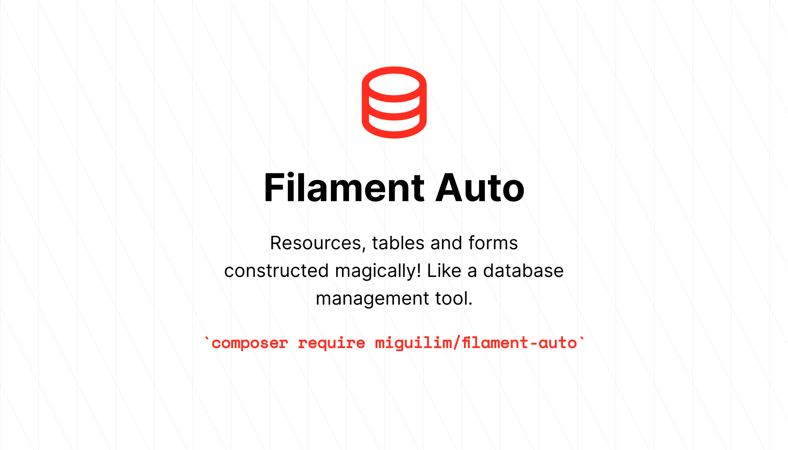

# Filament Auto Panel

[](https://packagist.org/packages/miguilim/filament-auto-panel)
[](https://packagist.org/packages/miguilim/filament-auto-panel)

Construct your Filament panel Resources and Relation Managers at execution time like magic.
This package provide custom Resources and Relation Managers classes that mounts it table, create, view
and edit pages at execution time by scanning the database current table schema while still giving you
the freedom to create actions, widgets and various customizations to your panel.


> [!IMPORTANT]
> This package is intended for admin panels, similar to how Laravel Nova works + everything auto-generated. You can also think it as a database management tool. If you feels you need a more customized resource workflow, re-consider to not use this package.

## Contents

- [Installation](#installation)
- [Usage](#usage)
  - [Soft Deletes](#soft-deletes)
  - [Primary Key](#primary-key)
  - [Relationship Linking](#relationship-linking)
  - [Automatic Guessing](#automatic-guessing)
  - [Polymorphic Relationships](#polymorphic-relationships)
  - [User Fields](#user-fields)
  - [Default Pages](#default-pages)
  - [Intrusive Mode](#intrusive-mode)
  - [Default Actions](#default-actions)
  - [Association Actions](#association-actions)
  - [Read-Only Mode](#read-only-mode)
  - [Default Sorting](#default-sorting)
  - [Table Filters](#table-filters)
- [Auto Resource](#auto-resource)
- [Auto Relation Manager](#auto-relation-manager)
- [Auto Action](#auto-action)
- [Enum Dictionary](#enum-dictionary)
- [Visible Columns](#visible-columns)
- [Searchable Columns](#searchable-columns)
- [Overwrite Columns](#overwrite-columns)
- [Appending Columns](#appending-columns)
- [Widgets](#widgets)
- [Extra Pages](#extra-pages)
- [License](#license)

## Installation

You can install the package via composer:

```sh
composer require miguilim/filament-auto-panel
```

## Usage

Before getting started with the package, you must know some behaviors that the table schema reader have.
The package takes into consideration your actual table schema in the database and not your migration file.
However, it is extremely important to use the correct fields in the migration in order to generate the correct columns.

An example of that is when you use the `boolean()` column method on MySQL or MariaDB, Laravel will generate a `tinyint(1)` table column. This
specific column type and length will be used by Filament Auto Panel to detect its a boolean column. If you use the `tinyInteger()`
method, it will generate a regular `tinyint` table column, and therefore will be identified as a numeric column, even if in its context
it is being used as a boolean.

Array/list casts use full-width `KeyValue` form fields and `KeyValueEntry` infolist entries.
For nested JSON, use an `object` cast, which gets a JSON text editor.

> [!NOTE]
> You can overwrite this auto-detection behavior by setting the cast for the column in your model class.

#### Soft Deletes

The package detects if the table has soft deletes or not by checking if it has the `SoftDeletes` trait,
by checking if `getDeletedAtColumn` method exists in the model. If soft deletes is detected, it will append the `TrashedFilter` to the table filters.

#### Primary Key

Filament Auto Panel tries to detect the primary key by calling the `getKeyName()` method from the resource / relation manager model. The primary key
is searchable by default and it will also be copyable in table and infolist view.

#### Relationship Linking

Columns ending in `_id` use a matching belongs-to relationship from your model. Forms get a searchable
`Select`. Tables and infolists link to the related resource if it is accessible and has a `view` page.

Form selects search the label column plus existing `id`, `name`, `title`, `email`, and primary-key
columns, without duplicates. Extra search columns exclude hidden, non-visible, encrypted, and hashed
attributes. Use a form column overwrite to change which columns are searched.

Dropdown options show **#ID** - name/title, omitting the name when unavailable. User options also show
the configured avatar and email, when available. Only the label changes; the saved foreign-key value is unchanged.

#### Automatic Guessing

The package uses the following conventions:

| Column | Detection |
| --- | --- |
| `owner_id` | Uses `owner()` if it is a `BelongsTo` with the matching foreign key. |
| `author_user_id` | Tries `author_user()`, then `authorUser()`. |
| `subject_type` + `subject_id` | Uses a matching `subject()` `MorphTo`, regardless of column order. |
| `name` | First choice for related-record labels. |
| `title` | Used when `name` is missing. If neither exists, the primary key is used. |

Relationships must already exist on your model. Unmatched columns keep their normal fields.
Column overwrites and enum dictionaries take priority.

Text form fields containing `email` get email validation; `phone` or `tel` get telephone inputs.
Table and infolist text fields containing `link` or `url` become clickable links.

#### Polymorphic Relationships

Matching `_type` and `_id` pairs use `MorphToSelect` in forms: choose a model, then an existing record.
Changing the model clears the selected ID. Tables and infolists show the related record's `name`,
`title`, or key.

Model choices come from the active panel's accessible resources and respect Laravel's morph-map aliases.
String or UUID keys need a string morph-ID column. If either column is required, the pair is required;
otherwise, both can be cleared. Choosing a model always requires a record.

Pairs without compatible targets, incomplete pairs, and non-primary owner keys keep their raw fields.
An overwrite or enum dictionary on either column also prevents grouping. To replace the whole selector,
use `MorphToSelect::make('subject')->types([...])` in your form column overwrites.

> [!NOTE]
> Record queries use model global scopes, not the resource's `getEloquentQuery()` or per-record policies. Use a scoped component overwrite if you need additional restrictions.

#### User Fields

Belongs-to relationships to models implementing `Authenticatable` show an avatar in tables and form
dropdowns. Forms use `Select`, and infolists use `TextEntry`.

Avatars use the related model's `profile_photo_url` attribute or accessor. It must return a URL;
missing avatars show the label only. To use another attribute, configure the column in your
`AppServiceProvider::boot()` method:

```php
use Miguilim\FilamentAutoPanel\Filament\Columns\UserColumn;

public function boot(): void
{
    UserColumn::configureUsing(
        fn (UserColumn $column) => $column->avatarAttribute('avatar_url'),
    );
}
```

#### Default Pages

By default, the Auto Resource have a list and view pages. The create and edit record is available as a modal action in the list and view pages respectively.

#### Intrusive Mode

Auto Resources and Auto Relation Managers have the intrusive mode by default. When this mode is activated, the create and edit actions will not respect the `$fillable` and `$hidden` model attributes. If you would like to disable this behavior, you can set `protected static bool $intrusive = false;` in your resource or relation manager class.

#### Default Actions

By default, Auto Resource appends the following default actions:

- Bulk Actions: `DeleteBulkAction or RestoreBulkAction, ForceDeleteBulkAction`
- Table Actions: `ViewAction or RestoreAction`
- List Page Actions: `CreateAction`
- View Page Actions: `EditAction, DeleteAction or RestoreAction, ForceDeleteAction`

and Auto Relation Manager appends the following default actions:

- Bulk Actions: `DeleteBulkAction or RestoreBulkAction, ForceDeleteBulkAction`
- Table Actions: `ViewAction, EditAction or RestoreAction`
- Header Actions: `CreateAction`

#### Association Actions

Auto Relation Managers add association actions based on the relationship:

- `HasMany`: associate/dissociate when the foreign key is nullable and the inverse relationship exists.
- `MorphMany`: the same, but both the ID and type columns must be nullable.
- `BelongsToMany` / `MorphToMany`: attach/detach, even with non-nullable pivot keys, since these actions insert or delete pivot rows.

Set `associateAttachActions: false` to disable these actions. Read-only managers do not add them.

#### Read-Only Mode

Set `protected static bool $readOnly = true;` to disable default mutation actions, leaving `ViewAction`.
Custom actions are still available. Resource-backed managers inherit this setting from the resource.

To add create or edit actions back, use:

- `\Miguilim\FilamentAutoPanel\Filament\Actions\AutoCreateAction::make()`
- `\Miguilim\FilamentAutoPanel\Filament\Actions\AutoEditAction::make()`


#### Default Sorting

By default, the Auto Resource and Auto Relation Manager tries to set the table default sort for the following columns,
in priority order: the incrementing primary key, the model's creation timestamp, and its update timestamp.
The candidate must exist as a sortable table column. Explicit string or closure-based sorts are preserved.

> [!NOTE]
> You can customize the defaultSort() of your table (and any other method) by extending the `table(Table $table)` and use `parent::table($table)->defaultSort(...)`.

#### Table Filters

Auto Resources and Auto Relation Managers add a [Query Builder](https://filamentphp.com/docs/5.x/tables/filters/query-builder)
filter automatically. You can combine conditions with AND/OR groups.

Text, numbers, booleans, and dates get matching constraints. Enum casts and `$enumDictionary` use
selects. Supported belongs-to relationships get a record selector; other relationships use their raw
foreign keys. Morph relationships keep separate type and ID conditions.

JSON, binary, hidden, encrypted, and hashed fields are skipped. Relation managers also exclude their
owner columns. Existing filters from `getFilters()` and the soft-delete filter are kept.

To replace the generated filter, return your own `QueryBuilder` from `getFilters()` using its default name:

```php
use Filament\QueryBuilder\Constraints\TextConstraint;
use Filament\Tables\Filters\QueryBuilder;

public static function getFilters(): array
{
    return [
        QueryBuilder::make()->constraints([
            TextConstraint::make('name'),
        ]),
    ];
}
```

## Auto Resource

You can get started by creating your first Auto Resource using the following command:

```sh
php artisan make:filament-auto-resource
```

This command creates the Auto Resource class for you, just as the default filament command. However, it uses the `AutoResource` class instead.
You don't need to list anything now, **you can just access the resource page and see the magic!**

## Auto Relation Manager

Auto Relation Manager construct a table containing the all relationship model columns, excluding the related id or morph.
You don't need to generate a relation manager file as you can use the `makeFromResource` method from `RelationManagerMounter` helper class:

```php
// UserResource.php
use Miguilim\FilamentAutoPanel\Mounters\RelationManagerMounter;

public static function getRelations(): array
{
    return [
        RelationManagerMounter::makeFromResource(
            resource: UserBanResource::class, // Auto Resource
            relation: 'userBans',
        ),
    ];
}
```

> [!NOTE]
> Optional parameters: `associateAttachActions`.

Or if you don't have a resource for your relation manager, you can use the `makeStandalone` method:

```php
// UserResource.php
use Miguilim\FilamentAutoPanel\Mounters\RelationManagerMounter;

public static function getRelations(): array
{
    return [
        RelationManagerMounter::makeStandalone(
            relation: 'userBans',
            visibleColumns: ['reason', 'created_at'],
        ),
    ];
}
```

> [!NOTE]
> Optional parameters: `searchableColumns`, `enumDictionary`, `recordTitleAttribute`, `associateAttachActions`, `intrusive`, `readOnly`.

However, if you need a more customized relation manager, you can create a file with the following command:

```sh
php artisan make:filament-auto-relation-manager
```

This command creates the Auto Relation Manager for you and you must list it in the `getRelations()` method of your resource.

## Auto Action

The Auto Resource and Auto Relation Manager provides a `getActions()` method, however you cannot use the default Filament action on it.

Instead, you must use the `AutoAction` class. This action type have same methods as Filament Actions, however it provide new methods to
set where the action will be shown. This is needed since there is only this array for all resource action positions.

The resource `action` closure always receive a collection of models. See how it works in the example below:

```php
use Miguilim\FilamentAutoPanel\AutoAction;
use Illuminate\Database\Eloquent\Collection;

public static function getActions(): array
{
    return [
        AutoAction::make('refund')
            ->label('Refund')
            ->icon('heroicon-o-arrow-path')
            ->color('danger')
            ->action(fn (Collection $records) => $records->each->refund())
            ->showOnTable()
            ->showOnViewPage(),
    ];
}
```

> [!NOTE]
> By default the auto action are not shown anywhere, so you must set at least one of the following methods: `showOnTable()`, `showOnBulkAction()`, `showOnViewPage()` or `showOnListPage()`.

## Enum Dictionary

Enum dictionary is a feature available to help you formatting a value from a column for your resource. This feature sets a `badge()` in table and infolist,
and use a `Select` in the form with the values you set. You can use it in the following way:

```php
protected static array $enumDictionary = [
    'type' => [
        0 => 'Default',
        1 => 'Administrator',
    ]
];
```

You may customize the badge colors with the following syntax:

```php
protected static array $enumDictionary = [
    'type' => [
        0 => ['Default', 'blue'],
        1 => ['Administrator', 'red'],
    ]
];
```

If you need to generate the enum dictionary dynamically, you can override the `enumDictionary` method:

```php
protected static function getEnumDictionary(): array
{
    return [
        // ...
    ];
}
```

## Visible Columns

By default all columns are shown in the Auto Resource or Auto Relation Manager table. You can customize the columns visibility using:

```php
protected static array $visibleColumns = [
    'name', 'email', 'created_at'
];
```

This feature only sets the column default visibility in the top-right menu of your table. You can enable/disable any column visibility at any time using the panel.

> [!NOTE]
> You cannot customize form or infolist columns visibility.

## Searchable Columns

You can set searchable columns for your Auto Resource or Auto Relation Manager using:

```php
protected static array $searchableColumns = [
    'name'  => 'global',
    'email' => 'global',
];
```

You have the following searchable options to use: `global`, `individual` or `both`.

## Overwrite Columns

Sometimes you may want to customize the resource columns entirely, you can overwrite the table column, form field or infolist entry with the `getColumnsOverwrite` method:

```php
use Filament\Tables\Columns\ImageColumn;

public static function getColumnsOverwrite(): array
{
    return [
        'table' => [
            ImageColumn::make('profile_photo_url')
                ->label('Profile Photo')
        ],
        'form' => [
            //
        ],
        'infolist' => [
            //
        ],
    ];
}
```

> [!NOTE]
> You cannot append new columns using this method, only overwrite detected columns. The `make()` parameter name must be the same as the column name in the database.

## Appending Columns

Even though the package does not support appending columns natively, you can easily do that by extending the parent method, keeping the generated content, and merging with your custom columns.

### Table

```php
use Filament\Tables\Table;

public static function table(Table $table): Table
{
    $generatedTable = parent::table($table);

    return $generatedTable
        ->columns([
            // Columns...
            ...$generatedTable->getColumns(),
            // Columns...
        ]);
}
```

### Form

```php
use Filament\Schemas\Schema;

public static function form(Schema $schema): Schema
{
    $generatedSchema = parent::form($schema);

    return $generatedSchema
        ->schema([
            // Columns...
            ...$generatedSchema->getComponents(),
            // Columns...
        ]);
}
```

### Infolist

```php
use Filament\Schemas\Schema;

public static function infolist(Schema $schema): Schema
{
    $generatedSchema = parent::infolist($schema);

    return $generatedSchema
        ->schema([
            // Columns here...
            ...$generatedSchema->getComponents(),
            // Columns here...
        ]);
}
```

> [!NOTE]
> If you want to add columns to the end of the table in a simpler way, you can just use `parent::table($table)->pushColumns([/* Columns */])` without the need to merge the generated columns.

> [!NOTE]
> If you want to add columns to the middle of the generated columns, you can slice the generated columns array. Example: `...array_slice($generatedColumns, 0, 2), /* Columns */, ...array_slice($generatedColumns, 2)`.

## Widgets

You can set widgets to the `list` and `view` pages for your Auto Resource independently in the following way:

```php
public static function getHeaderWidgets(): array
{
    return [
        'list' => [
            MyCoolStatsWidget::class,
        ],
        'view' => [
            //
        ],
    ];
}

public static function getFooterWidgets(): array
{
    return [
        'list' => [
            //
        ],
        'view' => [
            //
        ],
    ];
}
```

## Extra Pages

You can append extra pages to your Auto Resource using the `getExtraPages` method:

```php
public static function getExtraPages(): array
{
    return [
        MyCustomResourcePage::route('/custom-path'),
    ];
}
```

## License

Filament Auto Panel is open-sourced software licensed under the [MIT license](LICENSE).
